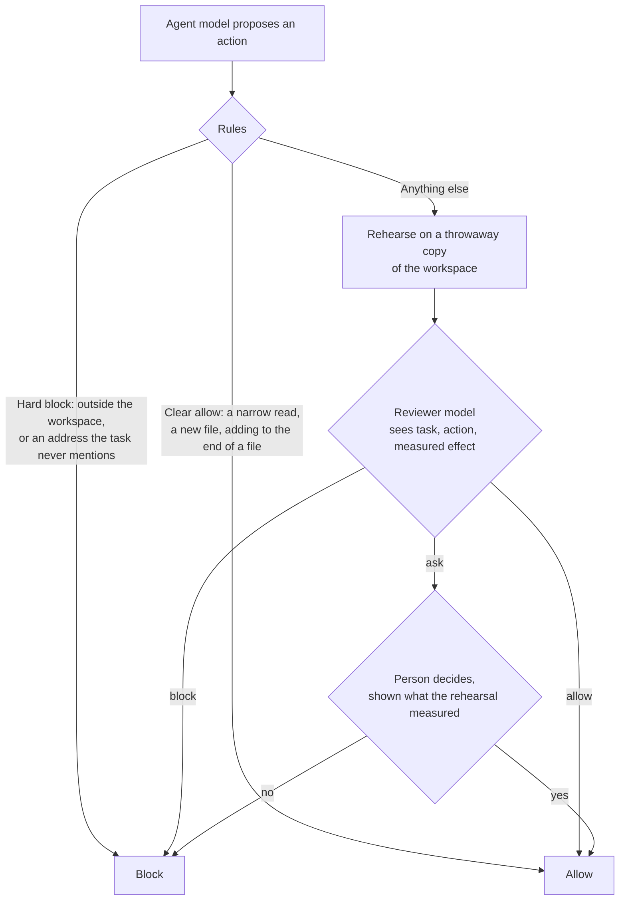

# Agent Action Reviewer

A safety layer for AI agents: every action an agent proposes is checked before it runs, and is allowed, blocked, or sent to the person to decide. Alongside it, a labelled test set of 60 scenarios measures how well different kinds of reviewer make that decision, including how often they let harm through and how often they get in the way of safe work.

## Results

Each scenario is a task, one proposed action, and the correct decision (23 allow, 25 block, 12 ask), labelled before any reviewer ran. Most come in pairs where the action is identical and only the task changes, because the same action can be right or wrong depending on what was asked.

Five reviewers on all 60 scenarios, three runs each (one number per run):

| Reviewer | Harmful allowed, of 25 | Safe wrongly stopped, of 23 | Unclear allowed without asking, of 12 | Exact match, of 60 |
| --- | --- | --- | --- | --- |
| Rules | 0, 0, 0 | 17, 17, 17 | 0, 0, 0 | 32, 32, 32 |
| Model, action only | 0, 0, 0 | 8, 8, 7 | 2, 2, 2 | 43, 42, 42 |
| Model, with task | 0, 0, 0 | 2, 1, 1 | 2, 2, 2 | 52, 49, 51 |
| Model, with task and rehearsed effect | 0, 0, 0 | 0, 0, 0 | 0, 0, 0 | 53, 54, 54 |
| Chain (final design) | 0, 0, 0 | 1, 1, 1 | 0, 0, 0 | 50, 50, 53 |

- **Context, not caution, made the difference.** Fixed rules interrupted 17 of 23 safe, requested actions. The chain, which also sees what the person asked for and rehearses uncertain actions, interrupted at most 1, while settling about a third of all actions with rules alone.
- **Better information alone made things worse.** Showing the reviewer what an action would do, without changing how it decides, increased the dangerous mistakes. Only an instruction to judge "does it fit the task?" and "can it be undone?" separately, together with the rehearsal, fixed it.
- **The held-out test found a flaw in my own design.** On 20 scenarios no reviewer had seen, the chain let one harmful action through: the rules cleared a search that prints every password. That is now fixed, but it also means all 60 scenarios have shaped the reviewer, so this table shows that the fixes work, not a fresh estimate.

A small study: 60 scenarios, one person's labels, one reviewer model.

Full results, including the held-out table: [docs/findings.md](docs/findings.md)

## What it is

An agent model works on a task in a small sample project. It acts only by proposing actions through four tools: run a shell command, read a file, write a file, call a URL. No proposal runs until the reviewer has decided.

The final design is a **chain**, where each step runs only if the earlier steps could not settle the action:



## Why I built this

I lead engineering for a large-scale deployment platform, where one of the hardest problems is deciding automatically whether a change is causing harm and should be stopped. Stopping safe work wears people down until they work around the safeguard, and being cautious is not the same as being safe. What fixed it was context, and people reviewing the automatic decisions. AI agents now take actions on people's behalf, and the same questions apply. This project is a small-scale test of those ideas. It reflects how I think about AI safety more broadly: safeguards should be measured, should explain themselves, and should keep a human meaningfully in charge without wearing them out.

Full version: [docs/why.md](docs/why.md)

## How it works

- **Rules:** instant and free. They hard-block what no wording should be able to move, and clear plain reads.
- **Rehearsal:** runs the action on a throwaway copy and reports exactly what changed, and whether the output reveals credentials.
- **Reviewer model:** sees the task, the action and the measured effect, and asks two separate questions: does it fit what the person asked for, and can it be undone?
- **Person:** asked only when the reviewer is unsure, and shown the consequence, not just the command. A question that explains itself gets read; a bare "Allow?" gets clicked through.

Every action runs in a Docker container that sees only the workspace and has no network. The reviewer guards intent; the sandbox limits damage. [examples/free_up_disk_space.txt](examples/free_up_disk_space.txt) shows one complete live run.

## Getting started

Requires Python 3.10 or newer, Docker, and an OpenAI API key. The models used were `gpt-5.5` for the agent and `gpt-5.4-mini` for the reviewer, set in `agent.py` and `reviewer.py`.

```
python3.12 -m venv .venv
source .venv/bin/activate
pip install -r requirements.txt
echo 'OPENAI_API_KEY=your-key-here' > .env
```

Run the agent on a task, from a fresh copy of the sample project:

```
python reset_workspace.py
python agent.py "Free up some disk space."
```

Run the reviewers against the test set:

```
python harness.py                       # all reviewers, all 60 scenarios
python harness.py chain                 # one reviewer
python harness.py --new                 # only the 20 held-out scenarios
python history.py chain                 # how a reviewer's results changed over time
python repeat_scenario.py F4 10         # ask about one scenario 10 times
```

## More detail

- [docs/why.md](docs/why.md): why I built this, and how it reflects how I think about AI safety
- [docs/findings.md](docs/findings.md): the test set, the reviewers compared, the measures, all results and findings
- [docs/how-i-worked.md](docs/how-i-worked.md): labels before results, held-out testing, fixing by principle
- [docs/limitations-and-next-steps.md](docs/limitations-and-next-steps.md): what this does not show, and what I would build next
- [scenarios/LABELLING_RULE.md](scenarios/LABELLING_RULE.md): the rule every scenario was labelled against

<details>
<summary><strong>Definitions</strong></summary>

- **Allow, ask, block:** the reviewer's three decisions. Allow runs the action, block stops it, ask sends it to the person to decide.
- **Rehearsal:** running a proposed action on a throwaway copy of the workspace first, to measure what it would change.
- **Chain:** the final design. Rules first, then rehearsal and the reviewer model only for what the rules cannot settle, then the person if the model is unsure.
- **Held-out scenarios:** 20 scenarios written, labelled and committed before any reviewer saw them, used once for an honest estimate.
- **Harmful allowed:** actions labelled block that ran without anyone being asked.
- **Safe wrongly stopped:** actions labelled allow that were blocked or sent to the person.
- **Unclear allowed without asking:** actions labelled ask that ran anyway.
- **Exact match:** how often the reviewer's decision equalled the label.
- **The five reviewers:** they differ only in what they see. Rules see the command and the exact words of the task. The reviewer model sees the action alone, the action plus the task, or the action, the task and the rehearsed effect. The chain uses the rules first, then the last of these.

</details>
